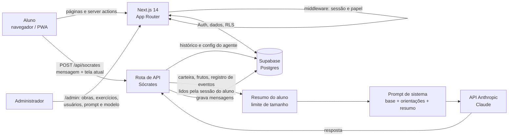

# Paideia

> Aplicativo web de formação clássica de nível médio: organiza obras, funções pedagógicas e exercícios, com um mentor de IA que conversa a partir do que cada aluno já fez.

[PREENCHER: GIF ou print da aplicação]

## O problema

Quem segue uma formação clássica por conta própria costuma ter o plano numa lista, as leituras em outra e nenhum interlocutor para discutir o que leu. Ferramentas de produtividade medem conteúdo consumido, não formação; chatbots genéricos não sabem o que a pessoa leu nem o que já produziu.

## A solução

O Paideia organiza a formação em torno de um conjunto pequeno de obras, sete funções pedagógicas e sete épocas, sem sequência obrigatória: o aluno entra por qualquer ponto. Os exercícios pertencem às funções, e voltar à mesma obra por outra função é o caminho para aprofundar. O que o aluno produz (os "frutos") e tudo o que ele faz vão para um registro de eventos, de onde se deriva o progresso.

O mentor de IA, o **Sócrates**, recebe a cada mensagem um resumo desse registro, montado no servidor, e conduz pelo método socrático: pergunta mais do que responde e nunca faz o exercício pelo aluno.

## Arquitetura



## Funcionalidades

- **Obras, Funções e Épocas:** catálogo das obras da formação, as sete funções pedagógicas e as sete épocas, cada uma com página própria e ligações entre si.
- **Carteira Intelectual:** obras do aluno e os frutos produzidos a partir delas.
- **Biblioteca.**
- **Sócrates:** conversas com o mentor de IA, com histórico por diálogo e ciência da tela em que o aluno está.
- **Progresso por função**, derivado do registro de eventos.
- **Administração:** cadastro de obras e exercícios, gestão de usuários e configuração do Sócrates (prompt, modelo, temperatura, limite de tokens).
- **Login** por e-mail e senha, com papéis de aluno e administrador; Google e Apple opcionais (OAuth do Supabase).
- **PWA** instalável.

[CONFIRMAR: descrição de cada tela; foi inferida das rotas e do PRODUCT.md]

## Stack

- **Frontend e backend:** Next.js 14 (App Router, server actions, route handlers), React 18, TypeScript, Tailwind CSS
- **Dados e autenticação:** Supabase (Postgres, Auth, Row Level Security)
- **IA:** API Anthropic (Claude) via `@anthropic-ai/sdk`
- **Testes:** Playwright (end-to-end)

## Decisões técnicas

1. **Resumo do aluno em vez do histórico inteiro.** A cada mensagem, `lib/socrates-contexto.ts` monta um resumo com as obras da Carteira, os frutos mais recentes, a contagem de eventos por função (mais e menos exercitadas), os últimos registros e a tela atual. O agente pergunta melhor sem receber dados brutos.
2. **Orçamento fixo de contexto.** O resumo tem limite de cerca de 6.000 caracteres (~1.500 tokens). Acima disso, corta primeiro os trechos de texto dos frutos e depois os eventos mais antigos, preservando o que mais ajuda a conversa.
3. **Ordem do prompt pensada para cache.** Prompt-base (estável) primeiro, orientações fixas em seguida e o resumo do aluno por último. A configuração do agente (prompt, modelo, temperatura, `max_tokens`) fica no banco e é editada pelo painel de administração, sem novo deploy. [CONFIRMAR: uso efetivo de prompt caching]
4. **Isolamento de dados por construção.** O resumo é lido com a sessão do próprio aluno: RLS e filtro por `user_id` garantem que nada de outro aluno entre no prompt, e a chave da API só existe no servidor.

## Resultados

[PREENCHER: usuários, uso ou outro resultado mensurável, se houver]

## Como executar

Pré-requisitos: Node.js [PREENCHER: versão mínima] e um projeto no Supabase.

```bash
npm install
```

1. No SQL Editor do Supabase, rode, nesta ordem:
   - `supabase/schema.sql` — tabelas, enums, triggers e políticas de RLS
   - `supabase/seed.sql` — dados iniciais e prompt inicial do Sócrates
   - os arquivos de `supabase/migrations/`, em ordem de data [CONFIRMAR: se o schema.sql já inclui as migrations]
   - opcional: `supabase/seeds/exemplo-*.sql`, dados de teste (cada um tem um script `-remover` correspondente)
2. Copie `.env.local.example` para `.env.local` e preencha:
   - `NEXT_PUBLIC_SUPABASE_URL`
   - `NEXT_PUBLIC_SUPABASE_ANON_KEY`
   - `SUPABASE_SERVICE_ROLE_KEY` (apenas no servidor)
   - `ANTHROPIC_API_KEY`
3. No Supabase Auth, habilite o provedor de e-mail e senha.
4. Rode o app:

```bash
npm run dev      # http://localhost:3000
npm run e2e      # testes end-to-end (Playwright)
```

5. Depois do primeiro cadastro, torne seu usuário administrador:

```sql
update perfis set papel = 'administrador' where email = 'seu-email@exemplo.com';
```

## Próximos passos

- [PREENCHER: próximos recursos planejados]
- Teste de leitura e compreensão.
- Formação personalizada por objetivo.
- Substituir os ícones provisórios do PWA pela identidade visual final.
