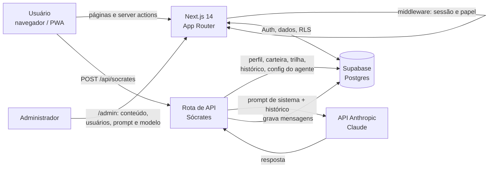

# Paideia

> Aplicativo web de autoformação clássica: organiza trilhas de estudo, leituras e rotina, com um mentor de IA que conversa usando o progresso real de cada usuário.

[PREENCHER: GIF ou print da aplicação]

## O problema

Quem estuda por conta própria seguindo a tradição clássica (artes liberais, grandes livros) costuma ter o plano numa planilha, as leituras em outra lista e nenhum interlocutor para discutir o que está lendo. Ferramentas genéricas de produtividade não modelam trilhas de formação, e chatbots genéricos não sabem em que ponto do caminho a pessoa está.

## A solução

O Paideia reúne num só lugar a trilha de formação, a "Carteira Intelectual" (leituras em andamento e planejadas), o planejamento das atividades e um mentor de IA, o **Sócrates**. A cada mensagem, o servidor monta o contexto do usuário (perfil, leituras em andamento, etapas recentes da trilha) e o injeta no prompt de sistema, para que o diálogo parta do ponto em que a pessoa realmente está.

## Arquitetura



## Funcionalidades

- **Início e Hoje:** visão geral e atividades do dia.
- **Mapa dos Estudos:** organização da formação em três trilhos.
- **Trilha de Formação:** etapas com status e percentual de progresso.
- **Carteira Intelectual:** leituras com status e progresso.
- **Biblioteca:** catálogo de obras ("ativos").
- **Planejamento:** criação e organização de atividades.
- **Sócrates:** diálogos com o mentor de IA, com histórico por conversa.
- **Administração:** edição de eixos, capacidades, trilhas, obras, usuários e da configuração do Sócrates (prompt, modelo, temperatura, limite de tokens).
- **Login** por e-mail e senha, com Google e Apple opcionais (OAuth do Supabase).
- **PWA** instalável.

[CONFIRMAR: descrição de cada tela; foi inferida dos nomes das rotas]

## Stack

- **Frontend e backend:** Next.js 14 (App Router, server actions, route handlers), React 18, TypeScript, Tailwind CSS
- **Dados e autenticação:** Supabase (Postgres, Auth, Row Level Security)
- **IA:** API Anthropic (Claude) via `@anthropic-ai/sdk`
- **Validação:** Zod
- **Testes:** Playwright (end-to-end)

## Decisões técnicas

1. **Contexto do usuário montado no servidor, a cada mensagem.** A rota `/api/socrates` busca perfil, leituras em andamento e progresso na trilha e os injeta no prompt de sistema. A chave da API nunca chega ao navegador, e o agente responde com base em dados atuais, não no que o usuário lembra de contar.
2. **Configuração do agente no banco, não no código.** Prompt de sistema, modelo, temperatura e `max_tokens` ficam na tabela `config_socrates` e são editados pelo painel de administração, sem novo deploy.
3. **Segurança em camadas.** O acesso ao `/admin` é verificado no `middleware.ts` e de novo na camada de sessão; as tabelas usam RLS, e a chave de service role só é usada em rotas de servidor.
4. **Histórico limitado às últimas 30 mensagens** por conversa ao chamar o modelo. [CONFIRMAR: motivo — controle de custo e de tamanho do contexto]

## Resultados

[PREENCHER: usuários, uso ou outro resultado mensurável, se houver]

## Como executar

Pré-requisitos: Node.js [PREENCHER: versão mínima] e um projeto no Supabase.

```bash
npm install
```

1. No SQL Editor do Supabase, rode, nesta ordem:
   - `supabase/schema.sql` — tabelas, enums, triggers e políticas de RLS
   - `supabase/seed.sql` — dados iniciais (eixos, capacidades, trilha das Sete Artes Liberais, obras de exemplo e prompt inicial do Sócrates)
   - os arquivos de `supabase/migrations/`, em ordem de data
2. Copie `.env.local.example` para `.env.local` e preencha:
   - `NEXT_PUBLIC_SUPABASE_URL`
   - `NEXT_PUBLIC_SUPABASE_ANON_KEY`
   - `SUPABASE_SERVICE_ROLE_KEY` (apenas no servidor)
   - `ANTHROPIC_API_KEY`
3. No Supabase Auth, habilite o provedor de e-mail e senha.
4. Rode o app:

```bash
npm run dev      # http://localhost:3000
npm run e2e      # testes end-to-end (Playwright)
```

5. Depois do primeiro cadastro, torne seu usuário administrador:

```sql
update perfis set papel = 'administrador' where email = 'seu-email@exemplo.com';
```

## Próximos passos

- [PREENCHER: próximos recursos planejados]
- Substituir os ícones provisórios do PWA pela identidade visual final.
- Ampliar a cobertura de testes end-to-end além do fluxo de administração.
